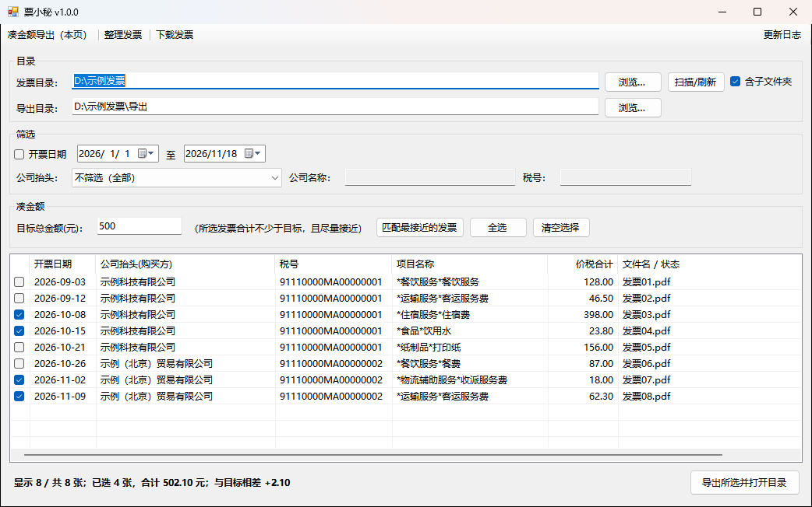

# 票小秘（PiaoMate）

  

Windows 桌面小工具，帮你管理电子发票 PDF：凑金额报销、按抬头分类整理、通过链接/二维码下载发票、扫码开票自动填写。单个 exe，免安装。



## 下载

到 [Releases](../../releases) 下载最新的 `PiaoMate-v<版本>.zip`，解压后双击 `PiaoMate.exe` 即可运行，无需安装。

## 功能

- **凑金额导出**：扫描发票目录，按开票日期、公司抬头筛选；输入目标金额，自动勾选合计「不少于目标且最接近」的发票组合，导出到带时间戳的文件夹并生成清单。
- **整理发票**：按 `抬头_税号\` 分类复制，文件名为 `金额_抬头_税号_发票号_开票日期.pdf`；SHA-256 校验，确认后才把原文件移入回收站。
- **下载发票**：粘贴发票链接、二维码截图或图片链接，自动下载 PDF 并整理。已适配：诺诺网、百望云（其他平台按通用方式尝试，欢迎提交适配）。
- **扫码开票**：二维码打开的是开票申请页时，用内置浏览器（WebView2）自动填写抬头、税号、手机、邮箱，并红框标出提交按钮——**由你核对后自己提交**，生成的 PDF 自动整理。
- 列表右键「打开所在目录并选中」「复制文件地址」，鼠标悬停显示发票概要；工具栏「更新日志」查看版本改动。

使用说明见 [docs/快速使用手册.md](docs/快速使用手册.md) 与 [docs/使用说明.md](docs/使用说明.md)，版本改动见 [CHANGELOG.md](CHANGELOG.md)。

## 运行环境

Windows 10/11（自带 .NET Framework 4.8）。扫码开票需要 Microsoft Edge WebView2 运行时（Windows 11 自带）。

## 从源码构建

需要 [.NET SDK](https://dotnet.microsoft.com/download)（6.0 或更高）。

```powershell
dotnet build src -c Release -o build\out          # 生成 build\out\PiaoMate.exe（依赖已嵌入，单文件）
dotnet run --project tests\PiaoMate.Tests    # 运行测试
```

测试使用运行时生成的**虚构发票**（需要系统字体「等线」Deng.ttf 或「黑体」simhei.ttf），不依赖任何真实发票。

## 公开版与内部版

源码中不包含任何公司的抬头和税号。备选公司可在软件配置文件 `PiaoMate.config` 中用 `CompanyN=公司名称|税号` 添加。

如需给自己公司构建**内置备选公司的内部版**：

1. 复制 `internal\companies.example.txt` 为 `internal\companies.txt`，每行填写 `公司名称|税号`（该文件已被 `.gitignore` 排除，不会提交）。
2. 构建：`dotnet build src -c Release -p:Edition=Internal`，或用发布脚本 `.\tools\release.ps1`（同时生成公开版和内部版）。

内部版标题栏显示「（内部版）」。

## 发布

```powershell
.\tools\release.ps1 -AddNote "改动说明" [-Type 新增|改进|修复]   # 记录改动到 CHANGELOG「未发布」
.\tools\release.ps1 [-Bump minor|major] [-Edition All|Public|Internal]
```

脚本会升版本号、写入更新日志、运行测试、编译并打包到 `build\dist\`。

## 参与贡献

欢迎反馈问题和适配新的开票平台，见 [CONTRIBUTING.md](CONTRIBUTING.md)。发现隐私或安全问题请按 [SECURITY.md](SECURITY.md) 私下报告。

## 许可协议

[MIT](LICENSE)。第三方依赖：PdfPig（Apache-2.0）、ZXing.Net（Apache-2.0）、Microsoft Edge WebView2 SDK（BSD-3-Clause）。

## 隐私

发票包含敏感信息。请不要把真实发票、个人配置（`PiaoMate.config`）或 `internal\companies.txt` 提交到仓库；`.gitignore` 已默认排除 PDF/OFD、`mock/` 中的样例和这些文件。
